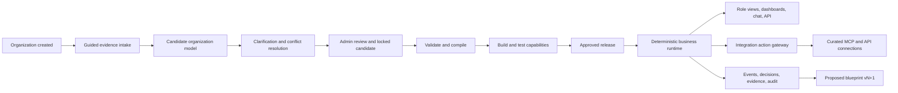

# Proactive Austra organizational runtime

Status: proposed architecture, 16 November 2026. This describes a target system, not an active business rule or a released capability.

## Goal

When a new organization is created, Austra starts a guided discovery process. It gathers evidence, asks the organization admin to resolve consequential gaps, presents a reviewable organization blueprint, and locks a confirmed release candidate. Austra then builds, tests, and fixes the requested capabilities against that candidate before publishing an active version. The operational runtime enforces the validated model for every actor and channel.

The organization blueprint is the source for policies, authority, workflows, data definitions, integrations, and generated views. Chat, dashboards, APIs, and external apps are clients of the same runtime. AI drafts and explains. Typed services validate, authorize, execute, and audit.

The existing SaaS identity, tenant isolation, department RBAC, and audit work remains the access foundation. Business authority is an additional decision: RBAC may allow a user to open purchasing, while a dated authority rule decides whether that user may approve a particular purchase order amount.



## 1. Onboarding contract

An `organization.created` event creates an onboarding case in the tenant. On first organization admin sign-in, Austra opens that case and asks for the business description and the outcome the admin wants first. The admin can upload TXT, PDF, DOCX, CSV, or XLSX evidence. Austra then asks for the organization's website and optional LinkedIn Page URL, offers a preview of what it can read, and asks whether there are more documents, business rules, or desired automations.

Website and Page content are supporting evidence. A public website can be fetched from the admin supplied domain with bounded crawl depth and recorded fetch time. LinkedIn data uses content the admin can lawfully access through an approved connection or an admin supplied export; if access is unavailable, the admin can supply the relevant Page text. No text found on a page or in a file can grant permissions or issue operational instructions.

Each extracted claim records tenant, source ID and location, retrieval time, author when known, and status: `unconfirmed`, `confirmed`, `rejected`, or `superseded`. Austra preserves conflicting claims side by side. Public marketing copy is never silently promoted into an internal operating rule.

The discovery agent drafts these sections:

| Section | Minimum content |
| --- | --- |
| Organization | What it sells or does, locations, customers, key terms, and sources |
| Capabilities | Outcomes the organization can deliver, each with an owner |
| Actors | Departments, people or service identities, external parties, and their roles |
| Authority | Who may decide what, limits, delegation, escalation, and effective dates |
| Policies | Constraint, rationale, owner, exceptions, and evidence |
| Events and workflows | Trigger, states, transitions, failure path, and completion condition |
| Data | Business entities, identifiers, units, source of truth, retention, and ownership |
| Integrations | App, read/write purpose, connection owner, scopes, and data mapping |
| Projections | Needed dashboard, form, queue, report, API, or ERP module by actor |
| Acceptance | Concrete examples with inputs, expected decisions, and side effects |

Questions are prioritized by the consequences of guessing. Austra asks one focused group at a time, cites the conflicting evidence, records the answer and its authorized respondent, and revises the candidate model. Typical blockers are an unknown approval limit, competing stock definitions, missing workflow owner, unclear customer identity, or unspecified email recipient. Cosmetic details can be deferred; missing authority, side effect, or source of truth cannot.

Before confirmation, the admin sees a plain language summary and the exact proposed behavior: what Austra will create, which data it will read, which actions it may take, who approves them, what remains manual, and sample outcomes. A readiness check requires zero unresolved execution critical questions, valid source links, named owners, explicit integration scopes, and testable acceptance examples.

The admin's confirmation locks an immutable blueprint release candidate with a content hash, approver, approval time, and source references. Builders work against that exact candidate. Feedback before go-live may create revised candidates and require the admin to reconfirm changed business meaning; none becomes an active organization version until the capability passes acceptance and is released. After go-live, a requested change to business meaning creates a draft vN+1 while active vN continues to run.

## 2. Semantic model and compiler

Persist first class, tenant scoped versions of `Capability`, `Actor`, `Authority`, `Policy`, `Knowledge`, `Event`, `Workflow`, `BusinessObject`, `Integration`, and `Projection`. Their typed links matter as much as their content: an authority grants an actor a decision in a capability; a policy constrains that decision; an event invokes a capability; knowledge supports a policy; a projection exposes permitted actions. Each version carries owner, rationale, source IDs, recorded time, effective start and end, and supersession link.

PostgreSQL can hold the relational index and transactional versions; evidence bytes can remain in tenant scoped object storage. The requirement is semantic queries and constraints, not a particular graph database. An `as_of` query must reconstruct the relevant policy and authority for a historical event, including the reasons and sources in force then.

The compiler accepts only a confirmed blueprint version. It checks references, state transitions, conflicting rules, units, missing owners, effective date overlap, permissions, tool scopes, and acceptance examples. It emits a versioned execution manifest: decision tables, event routes, typed data mappings, required approvals, permitted external tools, and projection descriptors. The runtime never executes model authored Python or JavaScript from a chat.

Simple forms, queues, tables, reports, and dashboards can be generated from projection descriptors. A bespoke ERP module may need reviewed application code and a normal release. In both cases, mutations call the same typed capability API and authorization service. Generated views never become a second policy source.

## 3. Runtime and integration boundary

The runtime receives a typed command or event from chat, UI, API, webhook, or schedule. It resolves tenant, actor, department, active blueprint version, and resource; evaluates RBAC and business authority; applies the deterministic transition; then records the outcome. Each execution has an idempotency key, correlation ID, input references, model version, decision explanation, and side effect receipts. Retries use the same key. Failed executions enter a visible repair queue.

All external actions pass through an integration gateway. A connection is tenant owned and has a human owner, status, allowed tools, scopes, rate limits, and revocation path. The model sees tool names and schemas, never credentials. The gateway verifies the tool schema and current permissions again at execution time, sanitizes results, and records what was read or changed. An MCP server's self reported `readOnlyHint` is advisory; Austra's approved action catalog determines the allowed effect.

For low friction setup, Austra presents an app catalog in business language: what the app can read or change, the requested permission scopes, and a single **Connect** action. Prefer provider OAuth sign-in with the smallest useful scopes, so an admin signs in and consents without creating a developer app or pasting a token. Austra owns reusable OAuth client registrations; the organization owns only its consent and connection. Store tokens in a tenant scoped secret manager and refresh them server side. When a provider requires an API key, show the exact provider steps and collect it in a private form, never in chat. A generic remote MCP URL plus bearer token remains a fallback for services that support it. For LinkedIn, provide an upload or manual fallback when Page API access is unavailable.

The connection catalog has curated MCP and native API templates with names, icons, setup method, supported actions, scopes, event triggers, and health checks. A generic MCP connector discovers tools and schemas after authentication. A generic HTTP/API connector covers services without MCP, with reviewed authentication templates and typed requests. Adding a new app should usually mean registering and verifying a connector template, not changing the core runtime. If the service needs a provider specific OAuth review or a custom API behavior, that work happens once at the platform level and the admin sees a simple sign-in flow.

After connecting, Austra performs a safe verification call, shows which account was connected and what it can do, and asks the admin to approve the requested workflow access. Before any workflow goes live, it tests reads, mappings, trigger samples, error paths, and proposed writes in an isolated or preview mode. A failed or expired connection opens a repair card with **Reconnect** and a plain explanation. MCP standardizes tool discovery and calls; it does not remove provider consent, scopes, or an app's own access requirements. The integration catalog and private connection setup are how Austra reaches n8n-like breadth and ease of use, without making n8n part of Austra's runtime.

An email, payment, external record change, or other consequential side effect first becomes an `ActionProposal` with exact recipient, payload, source records, reason, and model version. The authorized human reviews that concrete proposal. Execution rechecks the current actor, rule version, connection, and payload before sending. A policy may explicitly authorize bounded automatic actions; the authorization is versioned and visible.

## 4. Agent roles and skills

Start with **five build time agent roles**, instantiated only when a case needs them, plus **one constrained runtime assistant**. A role is a prompt, skill set, and tool boundary, not a dedicated model service or a new source of authority. The deterministic case orchestrator owns states, retries, and gates.

| Agent role | Responsibility | Skills |
| --- | --- | --- |
| 1. Discovery | Read supplied files and approved web sources; extract claims with provenance; identify missing evidence | document and website intake, source classification, extraction, conflict detection |
| 2. Semantic designer | Interview the admin, model capabilities and authority, prepare the summary and candidate blueprint | elicitation, semantic modeling, question planning, version authoring |
| 3. Capability builder | Turn locked requirements into workflows, projections, and reviewed module changes | workflow authoring, integration mapping, dashboard generation, module scaffolding |
| 4. Verifier | Independently replay examples, test adverse cases, collect admin feedback, and return reproducible failures to the builder | scenario testing, permission testing, connector contract testing, feedback triage |
| 5. Supervisor | Route work, reconcile specialist output, track unresolved questions and defects, and present reviewable decisions | case orchestration, evidence reconciliation, impact analysis, release preparation |
| Runtime assistant | Answer and propose actions using only active model and scoped tools | evidence backed answers, action proposal, exception explanation |

These are logical roles. Early versions may run them sequentially with the same model and separate instructions. Add concurrent workers only when workload warrants it. Skills teach the agents *how* to discover, model, build, or test; they never grant access. Every tool call and artifact still uses the authenticated tenant context and the platform's permission checks.

## 5. Build and release lifecycle

```text
created -> collecting -> clarifying -> ready_for_review -> locked_candidate
locked_candidate -> building -> testing -> admin_preview
testing/admin_preview -> defect_found -> fixing -> testing
admin_preview -> accepted -> ready_for_release -> active_blueprint(vN)
active_blueprint(vN) -> business_change_draft -> review/build/test -> active_blueprint(vN+1)
active_blueprint(vN) -> implementation_bug -> fixing/testing/preview -> patch_release(vN)
```

The builder produces a traceable package: locked blueprint hash, execution manifest, integration mappings, generated projections or reviewed code diff, sample fixtures, expected results, required credentials and scopes, and rollback plan. The verifier runs unit, scenario, tenant isolation, permission, failure, and connector contract checks in an isolated tenant. Read only provider calls can be tested against connected services; writes use sandbox accounts or previews until an authorized release and action approval. The admin then tries the capability with representative examples and reports any mismatch through the preview.

Every test failure and feedback item becomes a reproducible defect with expected behavior, observed behavior, blueprint reference, and owner. The builder fixes it, the verifier reruns the affected tests and regressions, and the admin previews the corrected behavior. This loop repeats until the acceptance examples pass and the admin accepts the result. A bug fix changes the build revision, not the organization blueprint version. If feedback changes what the business wants, Austra amends the unreleased candidate and asks the admin to reconfirm the affected meaning. Only a business meaning change after release increments the active blueprint version. A production defect is fixed and released as a patch against the same active blueprint version, with tests and audit history.

A release gate checks that the artifact matches the confirmed blueprint, tests and admin preview pass, required connections are healthy, the approving actor still has authority, and existing data can be migrated or left intact safely. A code change follows the repository's review and CI workflow. A released business rule or workflow change creates a new model version and audit event. An implementation patch retains the same model version and records its own build and release IDs. The runtime can roll back to the last working release without erasing history.

Proactive work continues after onboarding: new evidence, a failed run, an expired policy, a changed provider tool schema, or a conflict between observed practice and the active model opens a review case. Austra proposes a versioned change and asks the right owner to confirm it. It does not silently alter the active model.

## 6. First vertical slice and acceptance

Use an isolated organization fixture for the existing sales order, inventory, purchase order, and email journey. The admin supplies an SOP, sample orders and stock, approval limits, email template, and app connections. Austra asks about stock availability, reservation rules, reorder threshold, PO limits, recipient, and exceptions until the consequences are defined. The admin confirms blueprint v1. The builder produces an order view, inventory view, PO draft and approval queue, and email proposal; the verifier replays the journey.

The first slice is complete when:

1. Every confirmed behavior and displayed field traces to blueprint v1 and its evidence; unsupported claims remain marked unknown.
2. The same state, event, and model version yield the same decision, regardless of chat, UI, API, or workflow entry point.
3. An order cannot reserve the same stock twice; retries do not create duplicate POs or emails.
4. RBAC and dated business authority both hold: a user can access only their organization and department, and a PO above their limit escalates.
5. A policy change creates v2; an as-of query still explains who could approve under v1 and why.
6. An external email proposal shows its exact content and recipient, waits for the required approval, and records the provider receipt.
7. A disconnected app, changed tool schema, conflicting source, or failed action stops the affected transition and produces a repair case.
8. A department dashboard and the runtime API show the same permitted work and decisions from the same compiled model.

## 7. Implementation order and current code mapping

| Step | Deliverable | Existing foundation |
| --- | --- | --- |
| 1 | Tenant onboarding case, evidence provenance, website intake, question loop, confirmed blueprint v1 | Organization provisioning, file extraction, chat, tenant RBAC |
| 2 | Typed semantic registry, temporal versions, compiler checks, as-of queries | Versioned artifacts, audit, PostgreSQL identity schema |
| 3 | One deterministic SO/inventory/PO decision and projection pipeline | Material planner, A2UI tables, formula tools |
| 4 | Admin friendly connection catalog, tenant scoped OAuth and MCP gateway, safe verification, sandbox replay | Remote MCP catalog, Gmail and Slack adapters |
| 5 | General workflow and dashboard generation; reviewed custom module builds | Draft/review lifecycle, frontend and backend artifact types |

The current `Files` workspace and several business routes still use the prototype storage path. Tenant scoping must reach those operations before organization onboarding or a connector can act on customer data. The existing remote MCP catalog is a useful starting point, but its generic authentication is bearer token based and it has no guided connection catalog or compiled workflow contract yet. The existing deterministic material planner shows the runtime pattern but is a specialized business calculation. These boundaries should be made explicit during migration rather than hidden behind a broader agent prompt.

## Reference points

- Organizational Computing idea brief supplied by the user, October 2026: semantics as source, human validation, deterministic execution, temporal authority, generated projections.
- [Plyxl product overview](https://plyxl.com/) and [Plyxl workspace description](https://plyxl.net/): request driven app and automation creation, connected tools, action review.
- [n8n integration catalog](https://n8n.io/integrations) and [n8n credential guidance](https://docs.n8n.io/integrations/builtin/app-nodes/n8n-nodes-base.trello/): reference for a searchable connector catalog and reusable credential setup. Austra does not depend on n8n.
- [LinkedIn Page API access guide](https://learn.microsoft.com/en-us/linkedin/marketing/quick-start): Page access and permissions depend on the member and approved application.
