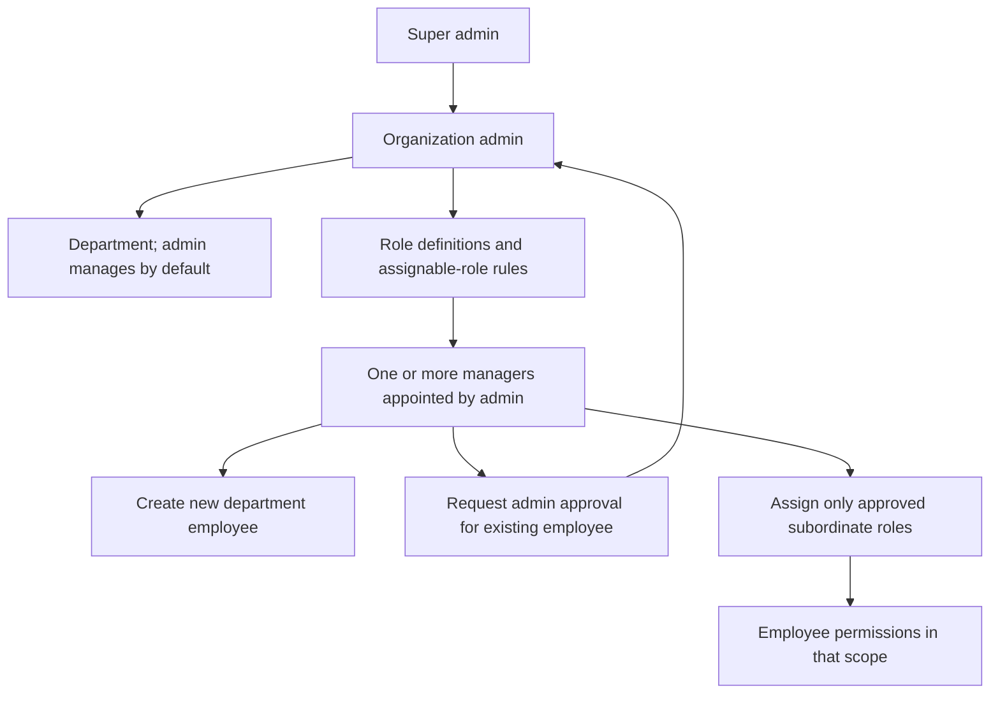
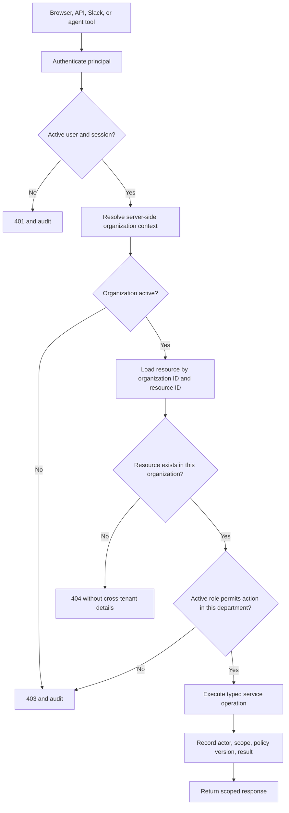
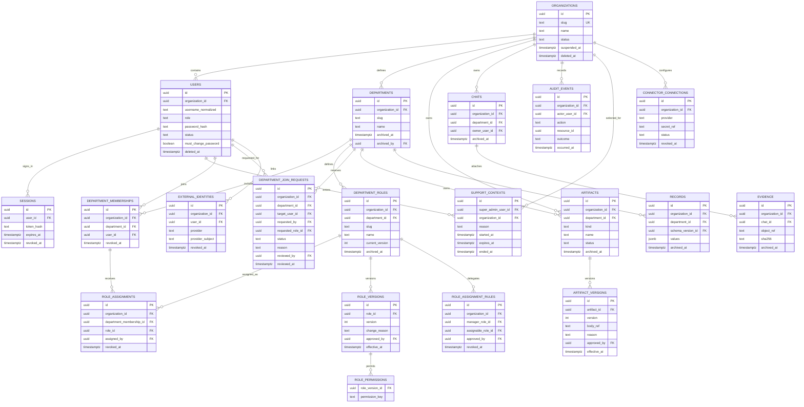
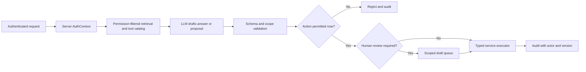

# Austra SaaS identity, departments, and access specification

Status: proposed architecture, 16 November 2026. This document is a delivery plan, not an active permission policy.

## 1. Goal and boundaries

Austra serves multiple organizations. The platform super admin provisions organizations and their first organization admin. An organization admin creates departments, department roles, business flows, and rules. Each department starts without a manager; the organization admin manages it by default and may appoint one or more managers. Department managers can add new employees and assign subordinate roles within their department. Adding an existing organization employee from another department requires organization admin approval. Other employees see and use only the departments and actions their roles permit. The agent can help discover and draft departments and business semantics, but server code decides identity, scope, permission, and publication.

The first release supports one organization per ordinary user, any number of departments per employee, and multiple roles within each department. Organization admins can define custom department roles from a fixed permission catalog. There is no separate team entity in this release. A super admin is a platform user with no home organization. Billing, public registration, cross-organization user membership, and arbitrary permission definitions are outside this release.

The existing local `admin.json` account, process memory sessions, one `Files` root, and `require_admin` dependency are prototype mechanisms. They must not become the SaaS authorization model. Existing business data is migration input; this plan does not alter the live workspace.

## 2. Nonnegotiable invariants

1. Every business object, retrieval result, background job, connector, cache entry, and audit event has an immutable `organization_id`. Department owned objects also have `department_id`.
2. The server derives user identity and organization from the authenticated session. Request bodies, URLs, chat text, and model output never establish authority or change the tenant context.
3. Authorization is default deny. A route, service operation, data query, agent tool, and external action check the same permission vocabulary. Hiding a UI control is only a usability measure.
4. Organization admins have organization wide business permissions and manage every department by default. Employees obtain permissions only from active role assignments in active departments. A super admin selects an organization and records a reason before accessing its business content.
5. Passwords and session tokens are never recoverable. A generated temporary password appears only in the create or reset response, is not stored in plaintext, and must be changed at first sign in.
6. Archiving a department immediately disables its roles, memberships, assignments, and active artifacts. History and audit remain available to authorized administrators.
7. LLM output is untrusted proposal data. It can neither grant access nor bypass a permission check, even if a document, tool result, or user prompt tells it to.
8. A policy or workflow that changes operational behavior is versioned, has an owner and reason, and is active only after an authorized human approves a validated draft.

## 3. Roles and permission model

| Principal | Scope | Allowed by default | Never implicit |
| --- | --- | --- | --- |
| Super admin | Platform; selected organization for support | Create, suspend, restore organizations; create or reset organization admins; inspect platform audit | Background access to every organization's content without selecting it and recording a reason |
| Organization admin | One organization | Manage its users, departments, department roles, assignments, connectors, policies, workflows, records, drafts, and audit | Any other organization or platform provisioning |
| Department manager | One assigned department | Create new employees there; manage members and assign approved subordinate roles; use business features granted by their own role | Changing role definitions, granting manager or admin authority, managing another department, or changing an existing user's organization wide account |
| Employee | Assigned departments in one organization | Union of permissions from active role assignments in the requested department | Access to an unassigned department, ungranted action, or platform settings |
| External actor | One linked identity and organization | Explicitly mapped actions for its channel and department | Rights inherited from the Slack workspace, email address, or agent identity alone |

Permission keys are stable code constants, not model generated strings: `chat.use`, `records.read`, `records.write`, `evidence.read`, `policies.read`, `policies.draft`, `policies.approve`, `workflows.read`, `workflows.draft`, `workflows.approve`, `workflows.run`, `reports.read`, `integrations.use`, `department.members.manage`, `department.users.create`, `department.roles.assign`, `departments.manage`, `roles.manage`, `users.manage`, and `audit.read`. Organization admin access is evaluated in code. Approval, department and role definition, organization user management, and audit permissions are admin only in the first release. No active role assignment means no business access. A workflow involving several departments requires the actor to have the relevant action in every department whose data or side effects it touches, unless the workflow has a separately approved service identity and delegation rule.

Department roles are permission bundles, for example Manager, Sales Operator, HR Analyst, and Viewer. The organization admin names and configures them per department; names do not confer power by themselves. A user may hold multiple roles, and allowed permissions are the union of active assignments in the requested department. There are no implicit role inheritance chains or explicit deny grants in the first release. A manager role has all three department management keys and an admin approved list of subordinate roles it may assign. Any role containing a management key is privileged and can be assigned only by the organization admin. The admin may appoint multiple managers in one department; managers cannot revoke or change one another's assignments.



Platform operations have separate permissions such as `organizations.manage` and `support.enter`. They cannot be assigned to an organization employee. Self service password change and session logout are available to every signed in user, regardless of department roles.

### Request decision



Authorization is checked again when a queued job runs, an agent calls a tool, an artifact is published, or a connector performs a side effect. The decision uses current user, membership, role, and assignment state so a revoked account cannot keep acting through an old job or session.

## 4. Provisioning and account lifecycle

1. Bootstrap the first super admin through a one time operator command in the deployment environment. Remove public first run `/api/setup` before network exposure. Migrate the current local admin deliberately; do not infer a company from chat contents.
2. The super admin creates an organization (`name`, unique `slug`, status, optional limits) and its first organization admin (`username`). The server generates a cryptographically random temporary password with at least 128 bits of entropy. The create response and a one time modal show it once. The response uses `Cache-Control: no-store`; the UI does not put it in local storage, logs, analytics, or a URL. Closing the modal loses the value.
3. The organization admin creates employees by username and assigns department roles. A manager with `department.users.create`, `department.members.manage`, and `department.roles.assign` can create a new employee directly into their department with an assignable subordinate role. Creation returns a one time temporary password to that manager. If the username already belongs to an active employee in the organization but not the department, the server creates a pending department join request; only the organization admin may approve it. Until approval, no membership or role changes. If the employee already belongs to the manager's department, the manager may assign an allowed subordinate role directly. A manager cannot create an organization admin or modify an existing user's organization wide identity.
4. Employee creation and organization admin password reset use the same one time credential flow. No read endpoint returns a password. If the recipient loses it, the organization admin resets it and receives a new one time password. A manager cannot reset a user's password because that account may have access to other departments.
5. First sign in allows only password change and logout. Password changes invalidate other sessions. Admin reset, user suspension, organization suspension, and role or membership revocation invalidate affected sessions or make their next authorization check fail.
6. Login identifies the organization by its slug or organization URL and the username. Super admin login uses a separate platform realm. Normalize usernames consistently and enforce uniqueness within an organization. Use generic login failure messages and rate limits.
7. Use a production password hasher such as Argon2id with versioned parameters; migrate the prototype PBKDF2 hash at bootstrap. Store only a hash of each opaque session token in durable shared storage, with expiry, rotation, revocation, and secure `HttpOnly`, `Secure`, `SameSite` cookies. Protect state changing browser routes against CSRF. Require MFA for privileged users before public SaaS launch.

The super admin can enter any organization from a platform screen by choosing it and entering a support reason. The server creates a short lived support context bound to that organization, records start and end events, and marks every subsequent audit entry with the super admin actor and support context. Exiting restores platform scope. Support access never changes the user's role into organization admin or hides who acted.

## 5. Department and business object lifecycle

An organization admin can create, rename, archive, and restore a department through direct CRUD. The admin can create custom roles within it and appoint zero, one, or several department managers; zero is the default, with the organization admin managing access. `name` is display text and `slug` is a stable active identifier unique within the organization. A department may own policies, workflows, formulas, schemas, records, evidence, chats, and agent skills. Organization shared objects have no department owner and require organization admin access until an explicit sharing model exists.

For a request such as “set up Sales and HR flows,” the agent may infer candidate departments and draft their flows, rules, and ownership links. It presents the inferred structure and source evidence. An organization admin approves the department and each behavior changing artifact; activation validates references, permissions, versions, and contradictions. Direct admin CRUD is a human authorized operation and does not need a second model approval. Employees may draft only where granted `policies.draft` or `workflows.draft`; publication requires an organization admin reviewer.

Archive is a transaction, not a physical delete. It sets `archived_at`, `archived_by`, and a reason on the department and each department owned active artifact; disables its roles, memberships, assignments, and pending join requests; cancels queued actions; removes those objects from active search, prompts, reports, and tool results; and writes one correlated audit event with the affected IDs. Records and evidence remain read only for audit and retention. An active cross department workflow or organization shared dependency must appear in a deletion impact preview. The admin must reassign ownership or explicitly archive the dependent workflow; a department delete cannot silently remove another department's data. Restore rechecks slug conflicts and references. Old role assignments are not silently restored.

### Manager delegation within a department

An organization admin defines each role's permission set and the subordinate roles a manager may assign. A role change shows which current users gain or lose access before approval; the new version then takes effect for all holders with an audit record. A Manager role may have business permissions plus `department.members.manage`, `department.users.create`, and `department.roles.assign`. A manager assignment is scoped to one department. Having the display name “Manager” without those keys grants no management authority.

| Action | Organization admin | Manager with all three department keys | Other employee |
| --- | --- | --- | --- |
| Create an employee account | Any employee in own organization | New employee in managed department only | No |
| Add an existing employee not yet in this department | Directly, or review a manager request | Submit a request; no access until admin approval | No |
| Assign or remove a role | Any role in own organization | Only subordinate roles on the admin approved assignable list, in managed department | No |
| Define or change a role or delegation rule | Yes | No | No |
| Assign a manager or organization admin role | Yes | No | No |
| Reset password, suspend user, or remove organization account | Yes | No; may remove own department membership for nonmanager employees | No |

Each manager action checks the actor's current role assignment, department scope, target user's organization, target department, and the exact role being assigned. The manager cannot assign roles to self, edit another manager's assignment, assign a role with department management or approval power, or edit the assignable-role list. The server rejects such requests even if the UI or LLM submits them. For an existing employee outside the department, a pending request records the target user, requested department and subordinate role, requesting manager, and reason. The organization admin approves or rejects it; approval rechecks current identities and permissions, then adds the membership and role atomically without changing other departments. An inactive user, organization admin, or platform account requires organization admin handling; the response does not expose whether a username exists in another organization. Removing the last department membership removes that department's access but does not delete the user account. Creation, requests, reviews, membership changes, and role assignments produce distinct audit events with actor and target IDs, never the temporary password.

Example: a Sales manager can create a new Sales Operator in Sales. To add an existing HR employee to Sales, the manager submits a request and the organization admin approves it. The manager cannot grant HR Analyst, create another Sales manager, inspect HR records, or reset a shared employee's password. Revoking the manager assignment takes effect on the next authorization check, including queued jobs and agent tools.

Organization suspension blocks sign in and jobs immediately while retaining data. Organization deletion is a separate platform retention process and is not implied by deleting a department.

## 6. Persistent schemas

Use PostgreSQL for transactional identity, role assignments, artifact metadata, and audit indexes. Keep large evidence bytes in tenant partitioned object storage. JSON may remain the format of an artifact body, but scope, relationships, versions, and lifecycle fields must be queryable and constrained. The first migration can retain existing file based business content behind a tenant scoped repository while metadata moves into the database.



`USERS.organization_id` is null only for a platform super admin; ordinary users have only `org_admin` or `employee` as their global role. A manager is an employee with an active department role assignment. The organization admin has implicit management authority in every department, even when no manager is appointed. Enforce the global role/scope combination with a check constraint. Ordinary usernames are unique on `(organization_id, username_normalized)` among active users; platform usernames have a separate unique index. Department roles have a unique active `(organization_id, department_id, slug)`. Use composite tenant and department foreign keys so a role, membership, assignment, join request, chat, and record cannot refer across organizations or departments. Give every query an `organization_id` predicate, supported by database row level security where practical. A scoped `AuthContext` carries the user, selected organization, support context, and current role assignments; repositories never accept a model supplied tenant ID.

Artifact and role versions are append only. A new active version supersedes the former one but does not overwrite it. `effective_at` enables historical policy and role resolution. Changing a role version rechecks all current assignments and invalidates permission caches immediately. A role assignment rule is approved by an organization admin, stays within one department, and cannot designate a manager or admin role as assignable by a manager in the first release. A department join request has a unique pending `(department_id, target_user_id)` constraint; approval or rejection records reviewer and timestamp. Cross department workflows keep explicit participating department links with one owning department; those links are checked during authorization and archive impact preview. Connector `secret_ref` points to a production secret manager and is never the secret value. Audit events include actor, originating channel, action, resource, tenant, department, role version, policy version, support context, request correlation ID, outcome, and reason; they never include passwords, tokens, document contents, or raw tool arguments. Backups and retention rules cover both database and evidence storage.

## 7. API and UI contracts

| Endpoint group | Principal | Operation |
| --- | --- | --- |
| `POST /api/platform/organizations` | Super admin | Create organization and first admin; return temporary credential once |
| `POST /api/platform/organizations/{id}/support-context` | Super admin | Enter audited organization context with reason |
| `POST /api/auth/login`, `/change-password`, `/logout` | Relevant account | Authenticate, rotate first password, revoke session |
| `GET/POST /api/org/users`, `POST /api/org/users/{id}/reset-password` | Organization admin | List/provision/reset without revealing stored passwords |
| `GET/POST /api/org/departments`; `PATCH/DELETE /api/org/departments/{id}` | Organization admin | Department CRUD; delete is archive with impact preview |
| `GET/POST /api/org/departments/{id}/roles`; `PATCH .../roles/{role_id}` | Organization admin | Define and version department roles |
| `PUT .../roles/{role_id}/assignable-roles` | Organization admin | Define the subordinate roles a manager role may assign |
| `POST /api/org/departments/{id}/members` | Organization admin or department manager | Create a new employee; admin may add an existing employee directly, while a manager creates a pending join request |
| `PUT /api/org/departments/{id}/members/{user_id}/roles` | Organization admin or department manager | Replace only assignments the actor may manage within this department |
| `DELETE /api/org/departments/{id}/members/{user_id}` | Organization admin or department manager | Remove a nonmanager's membership and roles from this department only |
| `POST /api/org/department-join-requests/{id}/review` | Organization admin | Approve or reject adding an existing employee to a department |
| `GET/POST /api/org/departments/{id}/artifacts` | Authorized user | Read or draft within department |
| `POST /api/org/drafts/{id}/review` | Authorized reviewer | Validate and publish or reject a scoped draft |

Collection responses return only authorized rows. Direct lookup of an object in another organization returns 404. An authenticated user lacking a known in-organization action receives 403. The manager add-member endpoint resolves the exact username inside the manager's organization in a transaction. If absent, it creates an `employee` in that department and returns a one time password. If already a member of that department, it may assign an allowed subordinate role. If the active employee belongs to the organization but not the department, it returns a pending join request and creates no access; the organization admin reviews it. It never returns an existing password or changes another department's membership. Conflicting privileged or inactive accounts require organization admin handling. Mutations require idempotency or revision checks where retries could duplicate accounts, requests, memberships, assignments, or publications. The response never echoes a password after the initial create/reset transaction.

The UI has a platform organization list and support switcher, organization People and Departments pages, a department role editor for the organization admin, a department roster and allowed-role picker for managers, an admin queue for pending department join requests, a one time credential modal with copy and “I saved it” close action, an impact preview for archive, and a department selector for employee chats and workspace views. A manager sees only their managed department and assignable subordinate roles. The active organization and department remain visible in the header. UI state never supplies the authority decision.

## 8. LLM and connector guardrails



1. Build context only from the actor's organization and authorized departments. Apply the same filter to chat history, short term memory, search indexes, evidence, approved policies, schemas, records, saved plans, and delegated research. Reauthorize each result and each tool call; a prompt instruction is not a role assignment.
2. Supply the model only a permission-filtered tool list. Each tool receives `AuthContext` from the server. Its inputs may select resource IDs but may not set `organization_id`, impersonate a user, or choose an unassigned department. Services enforce permissions after model output is parsed.
3. Treat uploads, email, Slack messages, external MCP results, and retrieved documents as evidence with no instruction authority. A request to reveal another department, change roles, print credentials, or ignore policy fails at the service boundary even if the model agrees.
4. Department inference and rule authoring produce scoped drafts. The model cannot create users, reveal or reset passwords, define or assign roles, change delegation rules, enter support context, or approve its own drafts. A manager creates users and assigns roles through typed authenticated UI or API operations, never through a model-authored action. Any connector side effect requires both a permission key and an explicit authorized user request or reviewed workflow authority.
5. Link each Slack or external identity to a particular user and organization before allowing business actions. Unlinked senders may receive a generic connection response but cannot read tenant data. Connector credentials and remote MCP catalogs are tenant scoped; cross-tenant tool reuse is forbidden.
6. Recheck permissions before sending an answer or executing a delayed action. If access was revoked during analysis, discard restricted output and record the denial. Remove archived department content from prompt construction and retrieval immediately, including caches and vector indexes.

## 9. Feature directory and ownership map

Target structure after incremental extraction. Keep route modules thin and most Python and JavaScript files under roughly 300 lines. Each feature owns its request models, service, persistence adapter, routes, and tests. Shared code contains only genuine cross-feature primitives.

```text
src/austra/
  app.py                         # app factory and router registration
  common/
    errors.py                    # shared domain errors
    clock.py                     # time source
    identifiers.py               # UUID and slug validation
  platform/
    auth/
      models.py                  # user/session API and domain types
      passwords.py               # generation, hashing, verification
      sessions.py                # durable session lifecycle
      service.py                 # login, first password change, reset
      routes.py
    organizations/
      models.py
      repository.py
      service.py                 # provisioning, suspend, support context
      routes.py
    audit/
      models.py
      repository.py
      service.py
  tenant/
    context.py                   # AuthContext and tenant resolver
    permissions/
      keys.py                    # fixed permission vocabulary
      evaluator.py               # one scoped authorization decision function
      dependencies.py            # FastAPI guards
    users/
      models.py
      repository.py
      service.py                 # employee lifecycle and credential flow
      routes.py
    departments/
      models.py
      repository.py
      service.py                 # CRUD, archive, restore, impact preview
      join_requests.py           # cross-department membership approval
      routes.py
    roles/
      models.py
      repository.py
      service.py                 # role versions and delegation rules
      assignments.py             # scoped manager assignment checks
      routes.py
    artifacts/
      models.py
      repository.py
      service.py                 # ownership, versioning, review
      routes.py
    chats/
      models.py
      repository.py
      service.py
      routes.py
    agent/
      context.py                 # scoped evidence assembly
      proposals.py               # typed draft validation
      tools.py                   # permission-aware tool dispatcher
      service.py                 # model orchestration
    integrations/
      identities.py              # external actor mapping
      connectors.py              # tenant scoped credentials/catalog
      service.py                 # authorized side effects
  storage/
    database.py                  # transaction and tenant context
    blobs.py                     # evidence objects
    migrations/                  # ordered SQL migrations
  static/
    features/
      auth/
      organizations/
      people/
      departments/
      roles/
      chats/
      workspace/
    shared/
      api.js
      state.js
tests/
  platform/auth/
  platform/organizations/
  tenant/permissions/
  tenant/users/
  tenant/departments/
  tenant/roles/
  tenant/agent/
  tenant/integrations/
  isolation/
```

Migration map: `web.py` becomes router registration in `app.py` and feature route modules; `access.py` splits into platform auth and tenant connector credential handling; `files.py` moves behind tenant repositories; `agent.py` becomes scoped agent context, proposals, and service; `tools.py` becomes permission-aware dispatch; `mcp_connections.py` gains organization ownership; `static/app.js` is split by feature. Keep temporary compatibility imports while tests and callers move. Do not rename everything in one change. Existing deterministic planners and reports remain business features and receive scoped repositories and `AuthContext` before being exposed to employees.

## 10. Delivery sequence and acceptance gates

| Phase | Work | Gate |
| --- | --- | --- |
| 0. Inventory and migration fixture | Snapshot current storage, identify references, map the local admin and workspace to explicit target identities without changing live data | Repeatable migration test on a copied temporary workspace; rollback documented |
| 1. Tenant and identity foundation | Database schema, operator bootstrap, generated credentials, login, durable sessions, organization provisioning and suspension | Restart preserves valid sessions; password is shown once; tenant A identifiers never retrieve tenant B data |
| 2. Department RBAC | Department CRUD, versioned custom roles, zero or more appointed managers, memberships, assignments, manager delegation rules, join approval queue, server dependency, scoped UI | Admin manages departments by default; manager creates new employees only in own department, requests approval for existing employees, and cannot assign manager roles; revocation and archive deny immediately |
| 3. Scoped business resources | Migrate chats, records, evidence, drafts, policies, workflows, formulas, search, jobs, and audit to organization and department scope | Every existing business endpoint and direct ID lookup has tenant and department tests; archive hides active content while preserving audit |
| 4. Agent and connectors | Filter context/tools, validate proposals, map external identities, gate side effects, remove cross-scope caches | Prompt injection and malicious tool arguments cannot read or mutate outside assigned roles; LLM cannot create users or assign roles |
| 5. Public SaaS readiness | MFA, secret manager, rate limits, CSRF, backups, restore rehearsal, monitoring, quotas, tenant isolation review | Independent security review and green CI before network deployment |

Minimum test matrix: unauthenticated, super admin without support context, super admin in context, organization admin, department with no manager, department with multiple managers, employee with multiple custom roles, employee with two departments, suspended user, archived department, cross organization guessed ID, stale session, stale background job, external unlinked sender, and adversarial document instructions. Verify manager creation of a new employee with a one time password, existing employee join request with no immediate access, admin approval and rejection, duplicate request handling, manager role assignment limits, self escalation rejection, cross-department denial, role version changes, and revocation during an agent run. Verify both read and write paths, UI and API, memory and search, and connector calls. Use isolated temporary organizations and workspaces for tests; do not exercise this plan against live business records.

After each application code change, run the project lint and test commands, then rebuild with `docker compose up -d --build app` and require `docker compose ps app` to report healthy. The plan itself changes documentation only and does not claim the running app has RBAC.
